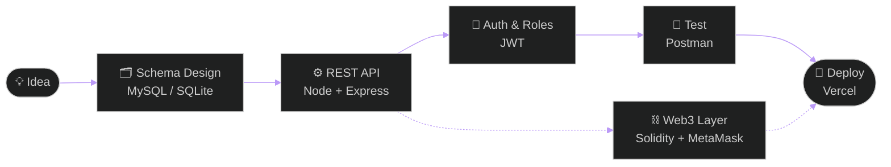

<!-- ═══════════════ HERO ═══════════════ -->

 

 

  

&nbsp;&nbsp;

&nbsp;&nbsp;

📍 Bengaluru, India &nbsp;·&nbsp; ✉️ abhishekraoh410@gmail.com

---

## 👋 About Me

<table>
  <tr>
    <td width="150"><b>🎓 Education</b></td>
    <td>B.E. Computer Science (2028) at <b>BMSIT&amp;M</b> &nbsp;·&nbsp; CGPA <b>8.94</b></td>
  </tr>
  <tr>
    <td><b>🧠 Focus</b></td>
    <td>Backend Architecture &nbsp;·&nbsp; Databases &nbsp;·&nbsp; Data Structures &nbsp;·&nbsp; System Design</td>
  </tr>
  <tr>
    <td><b>🌱 Learning</b></td>
    <td>Node.js / Express ecosystem &nbsp;·&nbsp; Web3 DApps &nbsp;·&nbsp; Smart contract optimization</td>
  </tr>
  <tr>
    <td><b>⚡ Active in</b></td>
    <td>Hackathons &nbsp;·&nbsp; Open Source</td>
  </tr>
  <tr>
    <td><b>🤝 Open to</b></td>
    <td>Internships &nbsp;·&nbsp; Collaborations &nbsp;·&nbsp; Hackathon teams</td>
  </tr>
  <tr>
    <td><b>💭 Philosophy</b></td>
    <td><i>Ship clean, scale smart, keep it simple.</i></td>
  </tr>
</table>

---

## 🧭 How I Build

---

## 🛠️ Tech Ecosystem

<table align="center">
  <tr>
    <td align="center" width="140"><b>Languages</b></td>
    <td>
      
    </td>
  </tr>
  <tr>
    <td align="center"><b>Web</b></td>
    <td>
      
    </td>
  </tr>
  <tr>
    <td align="center"><b>Backend</b></td>
    <td>
      
    </td>
  </tr>
  <tr>
    <td align="center"><b>Databases</b></td>
    <td>
      
    </td>
  </tr>
  <tr>
    <td align="center"><b>Tools &amp; Deploy</b></td>
    <td>
      
    </td>
  </tr>
</table>

---

## 📌 Featured Projects

<table>
  <tr>
    <td width="50%" valign="top">
      <h3>🎓 CampusPulse Event Portal</h3>
      
Full-stack portal with role-based auth, event CRUD, and registration tracking.

      
       <code>JWT</code> auth
        
      <a href="https://github.com/Abhishekrao123-tech"><b>View Code ↗</b></a>
    </td>
    <td width="50%" valign="top">
      <h3>🌱 EcoStream</h3>
      
Renewable energy tracking system with database triggers and automated reporting.

      
       <code>Tkinter</code> GUI
        
      <a href="https://github.com/Abhishekrao123-tech"><b>View Code ↗</b></a>
    </td>
  </tr>
  <tr>
    <td width="50%" valign="top">
      <h3>💸 Expense Tracker</h3>
      
Financial management app with secure authentication and expense categorization APIs.

      
        
      <a href="https://github.com/Abhishekrao123-tech"><b>View Code ↗</b></a>
    </td>
    <td width="50%" valign="top">
      <h3>⛓️ Split Bill DApp</h3>
      
Decentralized bill-splitting platform on Sepolia testnet with MetaMask integration.

      
       <code>MetaMask</code> · <code>Web3</code>
        
      <a href="https://github.com/Abhishekrao123-tech"><b>View Code ↗</b></a>
    </td>
  </tr>
</table>

---

## 📊 GitHub Activity

  

  

---

## 🏆 Highlights

> ⚡ **Hackathon participant & problem solver** — enjoys building under pressure
>
> 📈 **Open-source contributor** & system architecture enthusiast

---

<i>“Make it work, make it right, make it fast — in that order.”</i>

